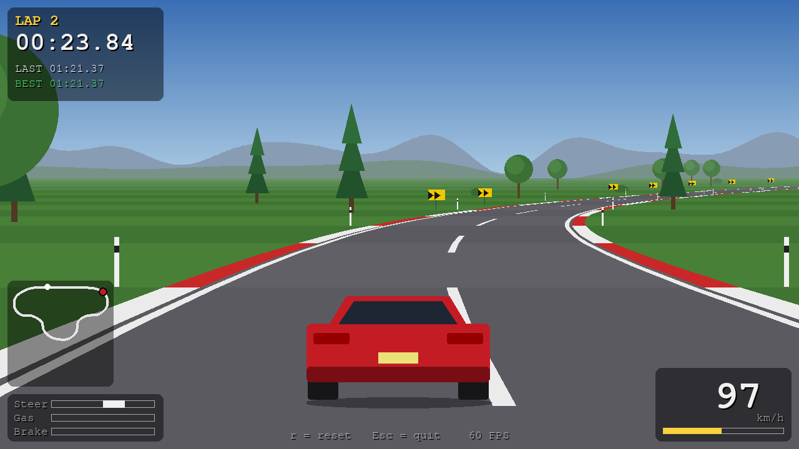
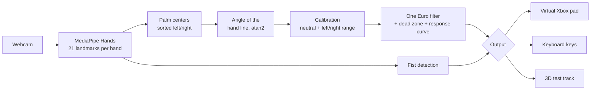

# Virtual Steering Wheel

Drive racing games with your bare hands: a webcam tracks both hands and turns them into an analog steering wheel, with no extra hardware.



The full project documentation (architecture, algorithms, physics, testing), with diagrams and charts, is in [docs/DOCUMENTATION.md](docs/DOCUMENTATION.md).

## Features

- **Hands as a wheel.** MediaPipe Hands finds both hands in the webcam image. The angle of the line between the palms becomes the steering value.
- **Smooth, analog steering.** A One Euro filter removes landmark jitter without adding noticeable lag, and a dead zone keeps the car straight when you hold still.
- **Gestures.** Make a fist with either hand to brake. Throttle is automatic.
- **Guided calibration.** Hold the wheel straight, then turn fully left and right, 3 seconds each. The result is saved and reused on the next start.
- **Works with real games.** Output goes to a virtual Xbox 360 controller (ViGEmBus + vgamepad), so any game with gamepad support sees a real analog stick. Without the driver, it falls back to keyboard keys.
- **Built-in 3D test track.** A pseudo-3D racing game written in PyGame, so you can try everything without installing a game:
  - a 2.1 km closed circuit with corners, hills, scenery, fog and a minimap;
  - a lap timer, off-track detection and spin recovery;
  - car physics based on a dynamic bicycle model, with Pacejka tires, a friction circle and weight transfer, tuned to road-car numbers;
  - a steering assist, stability control and a corner speed assist that keep it drivable with imprecise hand input.
- **Safe by design.** If the hands are lost, or on exit, Ctrl+C or a crash, the controller is reset to neutral, so no input stays stuck.
- **Tested.** 85 pytest tests cover the steering math, filter, gestures, calibration, controller outputs, camera thread, track geometry and car physics. None of them need a camera.

## Requirements

- Windows 10 or 11
- Python 3.10, 3.11 or 3.12. MediaPipe 0.10.14 has no wheels for newer versions.
- A webcam
- Optional: the [ViGEmBus driver](https://github.com/nefarius/ViGEmBus/releases), for the virtual gamepad output

## Quick start (Windows)

```powershell
git clone https://github.com/arianaDaboc/virtual-steering-wheel.git; cd virtual-steering-wheel
py -3.12 -m venv venv; venv\Scripts\python.exe -m pip install -r requirements.txt
.\run --output game
```

`run.bat` starts the program with the Python from `venv`, so you don't have to activate the virtual environment first.

Other ways to run it:

| Command | What it does |
|---|---|
| `.\run` | Picks the best output: virtual gamepad if ViGEmBus is installed, otherwise keyboard |
| `.\run --output game` | Built-in 3D test track |
| `.\run --output gamepad` | Virtual Xbox 360 controller, for real games |
| `.\run --output keyboard` | W/A/S/D keys, for games without gamepad support |
| `.\run --calibrate` | Runs the guided calibration again on start |

## How it works



1. **Capture and tracking** run on a background thread (`camera_worker.py`). The main loop always takes the newest result, so a slow frame never blocks drawing.
2. **Steering angle.** Each hand's palm center is MediaPipe landmark 9. The steering angle is `atan2(dy, dx)` of the line from the left palm to the right palm. Lowering the right hand turns right.
3. **Calibration** subtracts your "straight" angle and scales each side by the range you actually turn, so left and right reach full lock even if you turn one way further.
4. **Filtering.** The One Euro filter smooths more when the hands are still and less when they move fast, which keeps both jitter and lag low. A dead zone and a gentle response curve make small corrections easier.
5. **Gestures.** A hand is a fist when at most one finger tip is farther from the wrist than its middle joint.
6. **Output.** The same `(steer, throttle, brake)` values go to every output through one `Controller` interface. The game is just another output.

## Controls and gestures

| Input | Action |
|---|---|
| Both hands, like holding a wheel | Steer: tilt the line between your hands |
| Fist (either hand) | Brake |
| Open hands | Automatic throttle |
| `k` | Guided calibration (straight, full left, full right) |
| `c` | Quick re-center: the current position becomes "straight" |
| `g` | Turn sending inputs to the game on or off |
| `Space` | Skip the rest of the calibration |
| `r` | Reset the car to the start line (test track) |
| `q` or `Esc` | Quit |

All tunable values (sensitivity, filter, dead zone, car physics, assists, colors) are in [`config.yaml`](config.yaml). There are no magic numbers in the code.

## Challenges and how I solved them

**Latency and a stuttering game window.** MediaPipe takes most of each frame's time on a laptop CPU. At first the game redrew only when tracking finished a frame, so it moved at camera speed and felt choppy. I moved capture and tracking to a background thread that keeps only the newest result. The game now redraws at 60 FPS on its own clock and uses each new steering value as soon as it arrives. The HUD shows the real latency, from camera read to controller update.

**Landmark jitter.** Raw landmarks shake by a few pixels even when the hands are still, so the wheel trembled. A plain moving average fixed the shaking but added lag. The One Euro filter adapts its cutoff to the speed of the signal: it smooths heavily when the hands are still and lightly when they move fast. A small dead zone, rescaled so there is no jump at its edge, keeps the car straight at rest.

**Occlusion and losing a hand.** MediaPipe's left/right label can flip when the hands get close, so I sort the hands by screen position instead. Whenever exactly two hands are not visible, every output goes to neutral right away, so a car never keeps turning or accelerating on its own. The same happens on exit, Ctrl+C or an exception, through a `finally` block.

**Calibration that survives bad frames.** A one-frame calibration was unreliable. The guided calibration needs each pose held for 3 seconds and uses the median instead of the mean, so a single bad detection can't shift it. Single outlier frames count as glitches and are dropped. Several in a row mean the user is really moving, so the step restarts. A spread check rejects slow drift.

**Making real car physics drivable with hands.** A realistic car model spun out whenever the hands moved quickly, and when it was made stable it pushed wide in corners. I measured instead of guessing: at 118 km/h a speed-based steering limit left only 5° of wheel angle, and the automatic throttle reached corners faster than the tires could turn. I fixed it in three ways:

- **Steering assist.** The hands now request a share of the front tires' grip. The assist inverts the Pacejka tire formula to find the exact slip angle for that grip, relative to where the front axle is actually moving. As a result, cornering force grows in proportion to the hands at every speed, and the tires never go past their peak.
- **Stability control.** It brakes against excess yaw when the rear slides.
- **Corner speed assist.** It looks down the road and brakes early enough for each corner (`v² = a_lat/κ + 2·a_brake·d`).

I validated each change with simulated drivers, including shaky hands and 120 ms of input lag, and kept the results as tests.

## Results

These numbers come from the test suite and from a headless run of the game:

| Metric | Value |
|---|---|
| Test track redraw rate | 60 FPS, independent of tracking speed (tested with tracking slowed to 20 FPS) |
| Game simulation + rendering | ~4.6 ms per frame |
| Car: 0-100 km/h / top speed / 100-0 km/h braking | 7.3 s / 200 km/h / ~42 m |
| Car: maximum cornering grip | ~0.9 g |
| Steering assist: lateral grip at ¼ / ½ / full hands | 0.22 / 0.45 / 0.89 g, at 54, 90 and 126 km/h alike |
| Simulated shaky-handed driver (noise + 120 ms lag) | full laps, 0% off track, 0 spins |
| Automated tests | 85 passing |

Camera FPS and end-to-end latency depend on the webcam and CPU. Both are shown live in the HUD (`FPS` and `lat`).

## Known limitations and future work

- **Holding your arms up gets tiring.** There is also no force feedback, so precision is lower than with a real wheel or a gamepad.
- **Lighting matters.** In dim light or with a busy background, detection drops out more often, and the car then goes to neutral.
- **The throttle is not analog.** It is automatic, and braking is on/off. A natural analog gesture for the pedals is an open problem.
- **Windows only** for the gamepad and keyboard outputs. Tracking and the test track would run elsewhere.
- **Future work:**
  - a `--benchmark` mode that logs FPS, latency, detection rate and jitter to CSV;
  - a pinch gesture for analog throttle;
  - more tracks;
  - a GPU MediaPipe path for lower latency.

## Project structure

```
├── main.py            # main loop: wires everything together
├── camera_worker.py   # capture + hand tracking on a background thread
├── hand_tracker.py    # MediaPipe wrapper: both hands and their palm centers
├── steering.py        # angle, calibration offset, One Euro filter, dead zone, response curve
├── calibration.py     # guided calibration session, save/load
├── gestures.py        # fist detection
├── controller.py      # outputs: virtual gamepad, keyboard, none
├── display.py         # OpenCV window or game window
├── overlay.py         # OpenCV drawing (HUD, calibration panel)
├── metrics.py         # FPS and latency
├── game/              # 3D test track
│   ├── track.py       #   circuit geometry, hills, scenery, lap timer
│   ├── physics.py     #   bicycle model, tires, steering assist, ESC
│   ├── assist.py      #   corner speed assist
│   ├── render.py      #   pseudo-3D renderer
│   └── app.py         #   window, HUD, chase camera
├── config.yaml        # every tunable value
├── docs/              # project documentation, figures and screenshots
└── tests/             # pytest suite, no camera needed
```

Run the tests with:

```powershell
venv\Scripts\python.exe -m pytest
```

## Credits

- [MediaPipe Hands](https://ai.google.dev/edge/mediapipe/solutions/vision/hand_landmarker) (Google): hand landmark detection
- [ViGEmBus](https://github.com/nefarius/ViGEmBus) (Nefarius): virtual gamepad driver
- [vgamepad](https://github.com/yannbouteiller/vgamepad): Python bindings for ViGEmBus
- [pydirectinput](https://github.com/learncodebygaming/pydirectinput): keyboard input that works in DirectX games
- Géry Casiez, Nicolas Roussel and Daniel Vogel, [*1€ Filter: A Simple Speed-based Low-pass Filter for Noisy Input in Interactive Systems*](https://gery.casiez.net/1euro/), CHI 2012
- Hans B. Pacejka, *Tyre and Vehicle Dynamics*: the "magic formula" tire model
- The pseudo-3D road technique of classic arcade racers, as explained in Lou Gorenfeld's [*Lou's Pseudo 3d Page*](http://www.extentofthejam.com/pseudo/)
