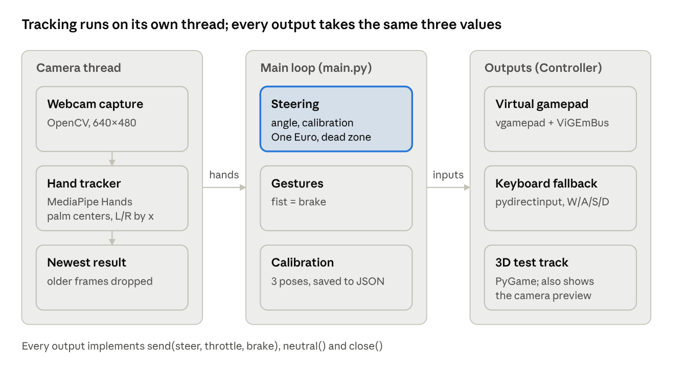
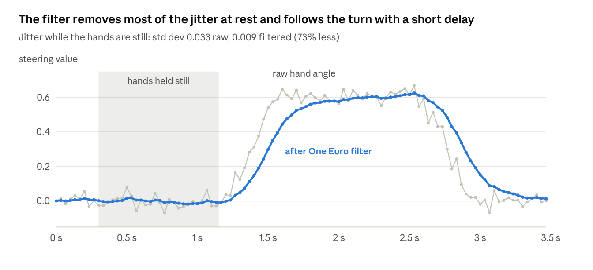
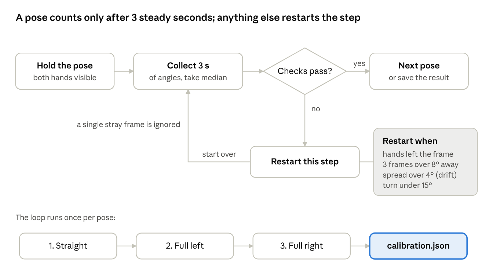
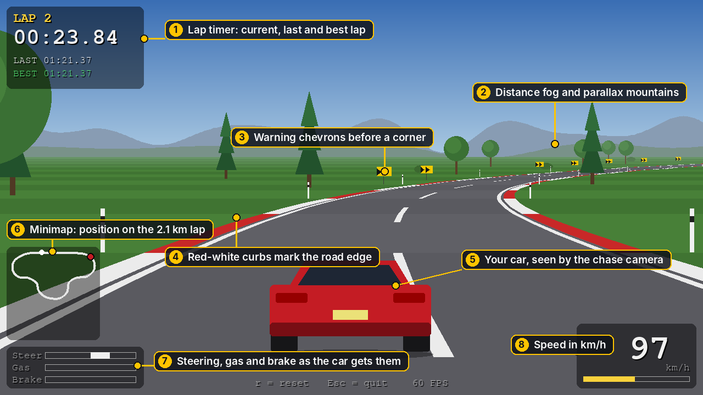
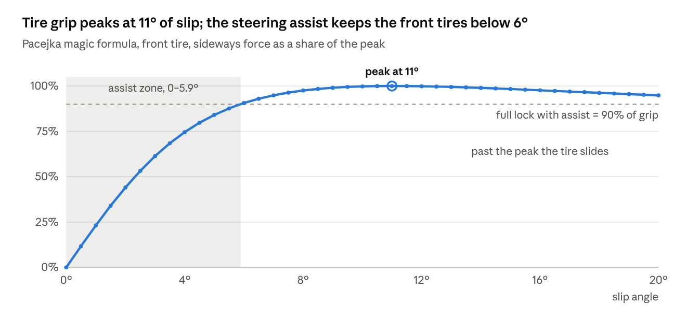
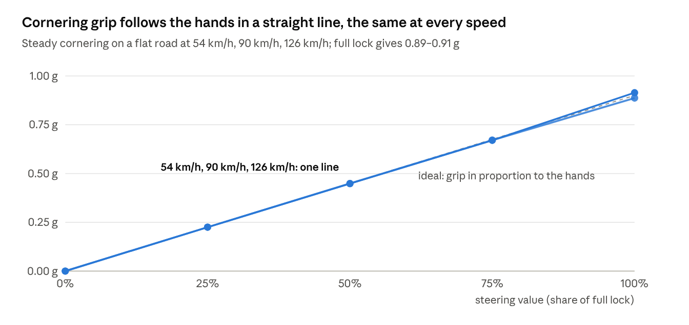
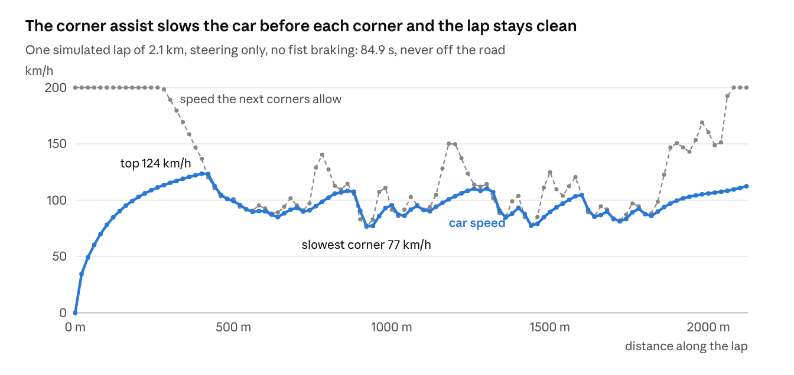

# Virtual Steering Wheel – Project Documentation

November 2026 · [Back to the README](../README.md)

## Abstract

Virtual Steering Wheel turns an ordinary laptop webcam into an analog steering wheel for racing games: the player holds both hands as if gripping a wheel, and tilting them steers the car. Hand landmarks come from MediaPipe Hands, and the steering angle is the slope of the line between the two palm centers. That angle is calibrated per user, smoothed with a One Euro filter, and sent to the game through a virtual Xbox 360 controller, a keyboard fallback, or a built-in 3D test track. A fist on either hand brakes; throttle is automatic.

The built-in track is a pseudo-3D racing game with a dynamic bicycle-model car (Pacejka tires, friction circle, weight transfer). Driver assists keep it controllable with imprecise hand input. The system runs on a CPU-only Windows laptop, redraws the game at 60 FPS independent of tracking speed, and is covered by 85 automated tests that need no camera.

## 1. Introduction and objectives

The project shows that a webcam and a CPU are enough to replace a physical steering wheel for casual racing, using only open-source computer vision. Racing games feel best with analog steering, but a gaming wheel costs money and desk space, and a keyboard only gives on/off steering. Hand tracking can provide a continuous steering value with no extra hardware.

Objectives:

1. Detect both hands in real time from a laptop webcam, without a GPU and without training any model.
2. Convert the hand pose into a smooth, analog steering value in the range \[-1, 1\].
3. Adapt to each user through a guided calibration that is saved and reused.
4. Drive real games through a virtual gamepad, with a keyboard fallback when the driver is missing.
5. Provide a self-contained 3D test track, so the system can be demonstrated without any external game.
6. Stay safe: any loss of tracking, error or exit must leave the controller in a neutral state.
7. Keep the code modular, configurable and testable without a camera.

Out of scope: force feedback, multiplayer, and a trained gesture model; the gestures are rule-based on MediaPipe landmarks.

## 2. Requirements

The system targets Windows 10/11 laptops with Python 3.10 to 3.12 and a built-in webcam; no GPU is required.

**Functional requirements**

| ID | Requirement |
| --- | --- |
| F1 | Detect two hands per frame and locate each palm center |
| F2 | Compute a steering value in \[-1, 1\] from the angle between the palms |
| F3 | Calibrate the neutral angle and the full left/right range, save it, reuse it on start |
| F4 | Recognize a closed fist on either hand as the brake |
| F5 | Apply automatic throttle while not braking |
| F6 | Send inputs to a virtual Xbox 360 controller; fall back to keyboard keys |
| F7 | Provide a built-in 3D test track with lap timing and off-track detection |
| F8 | Show an on-screen HUD with steering, pedals, FPS and latency |
| F9 | Keyboard shortcuts: calibrate, re-center, toggle output, quit |

**Non-functional requirements**

| ID | Requirement |
| --- | --- |
| N1 | Real time: the loop never drops below 25 FPS on a CPU-only laptop |
| N2 | Safety: tracking loss, exceptions and exit send neutral inputs |
| N3 | Configurability: every tunable constant lives in `config.yaml` |
| N4 | Testability: pure logic is tested without a camera |
| N5 | Light dependencies: only widely used, pip-installable libraries |
| N6 | Portability of paths: no hard-coded paths or secrets |

## 3. Technologies used

The project is written in Python and uses six main libraries, each chosen because it solves one part of the problem without a GPU or a trained model of our own.

| Technology | Role in the project | Why it was chosen |
| --- | --- | --- |
| Python 3.10-3.12 | Implementation language | Mature ecosystem for computer vision and fast prototyping |
| MediaPipe Hands 0.10.14 | Hand detection, 21 landmarks per hand | Pre-trained, real time on CPU; pinned to keep the `mp.solutions` API |
| OpenCV | Camera capture (DirectShow), image flip, color conversion, HUD drawing | Standard, fast, works with every webcam on Windows |
| NumPy | Palm coordinates and image arrays | Required by OpenCV and MediaPipe; efficient vector math |
| vgamepad + ViGEmBus | Virtual Xbox 360 controller | Games see a real analog stick and triggers |
| pydirectinput | Keyboard fallback | Sends scan codes that DirectX games accept |
| PyGame | Built-in 3D test track | Simple 2D drawing API, enough for pseudo-3D rendering |
| PyYAML | Configuration file | Human-readable settings with comments |
| pytest | Automated tests | Concise tests, fixtures, parametrization |
| Git, GitHub | Version control and publishing | Small, meaningful commits; public portfolio |

## 4. System architecture

The system is split into small modules connected by two interfaces, and hand tracking runs on its own thread so slow detection never blocks drawing.



*System architecture · 2 threads, 3 outputs*

The camera thread reads frames and runs MediaPipe; the main loop turns the newest result into steer, throttle and brake and passes them to whichever output is active.

**Data flow.** For each tracked frame: the palms give the raw angle; calibration, gain, the One Euro filter, the dead zone and the response curve turn it into a steering value; the fist rule gives the brake; the values go to the output; the overlay draws the HUD; the display shows the frame and returns the pressed key.

**Threading.** MediaPipe takes most of each frame's time on a laptop CPU (often 20–40 ms). The `CameraWorker` thread captures frames and tracks hands in the background and keeps only the newest result, protected by a lock and an event. The main loop waits for a new result only until its next redraw is due: the game redraws at 60 FPS on its own clock, while the plain OpenCV window redraws when a new camera frame arrives. The thread is stopped before the tracker is closed.

**Interfaces.** `Controller` (`send`, `neutral`, `close`) hides which output is used; `Display` (`show`, `close`, `refresh_interval`) hides whether frames go to an OpenCV window or into the game. The 3D test track implements both.

| Module | Responsibility |
| --- | --- |
| `main.py` | Command-line options, configuration, main loop, keys |
| `camera_worker.py` | Capture and hand tracking on a background thread |
| `hand_tracker.py` | MediaPipe wrapper: both hands, palm centers, sorted by x |
| `steering.py` | Angle, calibration offset, gain, One Euro filter, dead zone, response curve |
| `calibration.py` | Guided calibration session, save and load |
| `gestures.py` | Fist detection |
| `controller.py` | Gamepad, keyboard and null outputs |
| `display.py` | OpenCV window and the `Display` interface |
| `overlay.py` | HUD and calibration panel drawing |
| `metrics.py` | Camera FPS and capture-to-output latency |
| `game/` | 3D test track: `track`, `physics`, `assist`, `render`, `app` |
| `config.yaml` | Every tunable value |

## 5. Hand tracking and steering angle

The steering angle is the angle of the line from the left palm to the right palm, measured against the horizontal of the image.

**Hand detection.** Each camera frame (640×480, mirrored so the view feels natural) is converted from BGR to RGB and passed to MediaPipe Hands with `max_num_hands = 2` and the fastest model (`model_complexity = 0`). MediaPipe returns 21 normalized landmarks per hand. The palm center is landmark 9, the base of the middle finger, because it moves less than the fingertips and is visible even when the hand is closed.

**Left and right hand.** MediaPipe also labels each hand as left or right, but the label can flip when the hands come close. The module `hand_tracker.py` therefore ignores the label and sorts the two hands by their x position on screen. If the number of hands is not exactly two, the frame produces no steering value.

**Angle.** With the palm centers in pixels, the raw angle is:

```math
\theta = \operatorname{atan2}(y_R - y_L,\; x_R - x_L)
```

Image y grows downwards, so a positive angle means the right hand is lower, which is a right turn. Because the hands are sorted by x, the difference x\_R − x\_L is always positive and the angle stays within (−90°, 90°), with no wrap-around.

**From angle to steering value.** The calibration (section 7) gives a neutral angle and the measured range to each side. The normalized value is the offset from neutral divided by the range on that side, multiplied by a gain and clamped to \[-1, 1\]:

```math
s = \operatorname{clamp}\left( g \cdot \frac{\theta - \theta_0}{\Delta_{side}},\; -1,\; 1 \right)
```

The gain g = 1.4 means full lock is reached at about 70% of the calibrated turn, because people rarely rotate their hands to the maximum while driving.

## 6. Signal processing

Raw landmarks shake by a few pixels even when the hands are still, so the steering value passes through three stages before it reaches the game: a One Euro filter, a dead zone and a response curve (`steering.py`).

**One Euro filter.** A plain moving average removes jitter but adds lag in every situation. The One Euro filter (Casiez et al., 2012) is a first-order low-pass filter whose cutoff frequency adapts to the speed of the signal: low when the hands are still (strong smoothing), high when they move fast (little lag). For a sample x at time t, with Δt the time since the previous sample:

```math
\alpha(f_c) = \frac{1}{1 + \frac{1}{2\pi f_c \Delta t}}, \qquad \hat{\dot{x}}_t = \alpha(f_d)\,\frac{x_t - \hat{x}_{t-1}}{\Delta t} + (1 - \alpha(f_d))\,\hat{\dot{x}}_{t-1}
```

```math
f_c = f_{min} + \beta\,|\hat{\dot{x}}_t|, \qquad \hat{x}_t = \alpha(f_c)\,x_t + (1 - \alpha(f_c))\,\hat{x}_{t-1}
```

The project uses f\_min = 1.0 Hz, β = 0.02 and f\_d = 1.0 Hz. The filter uses real timestamps, so it behaves the same at any frame rate. After a calibration it is reset, because older samples were relative to the previous neutral angle.



*Simulated hand signal at 30 Hz with noise (std dev 0.035), run through the project's One Euro filter (f_min 1.0, beta 0.02)*

In the shaded part the hands are still and the filtered value barely moves; during the turn the filter speeds up and follows the raw value.

**Dead zone.** Values with |s| < d (d = 0.05) become zero, so the car goes straight when the hands are held still. The rest is rescaled so there is no jump at the edge of the zone:

```math
s' = \operatorname{sign}(s)\,\frac{|s| - d}{1 - d}
```

**Response curve.** Hands are not precise, so small movements are made gentler with s'' = sign(s')·|s'|^k, with k = 1.15. Full lock stays at 1.0, while half a turn gives 0.45 instead of 0.5.

## 7. Calibration

Calibration measures three raw angles for the current user (straight, full left, full right) and turns them into a neutral angle plus a separate range for each side. The logic lives in `calibration.py` as a small state machine that is fed one frame at a time and never touches the camera, so it is fully testable.

**Guided session.** The user holds each pose for 3 seconds while a progress bar fills. The steps are:

1. Hold the wheel straight → neutral angle θ₀.
2. Turn fully left → left span ΔL = θ₀ − θ\_left.
3. Turn fully right → right span ΔR = θ\_right − θ₀.

The two spans may differ, because people rarely turn equally far both ways. Each side reaches full lock at its own measured range.

**Robustness rules.**

- The value of a step is the median of its samples, not the mean, so a single wrong detection cannot shift it.
- A frame more than 8° from the running median is treated as a glitch and dropped. Three such frames in a row mean real movement (for example, turning into the next pose), so the step restarts from the new position.
- If the standard deviation of the samples exceeds 4°, the hands drifted slowly; the step restarts with the message "Hold still".
- A turn smaller than 15° is rejected ("Turn further left").
- If the hands leave the frame, the step restarts. During the whole session the controller only receives neutral inputs.
- Space skips the remaining steps; skipping before the center step cancels the session and keeps the previous calibration.



*Calibration session · per-pose loop and the three poses*

Every pose goes through the same loop; the result is saved only after all three poses pass, or after the straight pose if the user skips the rest.

**Persistence.** The result is saved to `calibration.json` next to the program and loaded on the next start, so the guided screen appears only the first time. Key `k` repeats the full session, key `c` only re-centers (the current angle becomes neutral, the measured ranges are kept), and `--calibrate` forces the session on start. A missing or corrupted file is ignored safely.

## 8. Gesture recognition

A closed fist on either hand is the brake; it is detected with a geometric rule on the landmarks, without a trained classifier (`gestures.py`).

For each of the index, middle, ring and little fingers, the rule compares two distances from the wrist (landmark 0): to the fingertip (landmarks 8, 12, 16, 20) and to the middle joint, the PIP (landmarks 6, 10, 14, 18). A finger counts as extended when its tip is farther from the wrist than its middle joint. The thumb is ignored, because its position varies a lot in a wheel grip.

A hand is a fist when at most one finger is extended (configurable as `max_extended_fingers_for_fist`). Allowing one finger avoids flicker when a single landmark is misplaced. Comparing distances from the wrist, rather than vertical positions, makes the rule work regardless of how the hand is rotated, which matters because the hands are tilted while steering.

While either hand is a fist, the output is brake = 1 and throttle = 0; otherwise throttle is the automatic value (0.6) and brake is 0.

## 9. Controller outputs

Every output implements the same `Controller` interface, `send(steer, throttle, brake)`, plus `neutral()` and `close()`, so the main loop never knows which output is active (`controller.py`).

| Output | How it works | When it is used |
| --- | --- | --- |
| Virtual gamepad | vgamepad creates a virtual Xbox 360 pad through the ViGEmBus driver: left stick X = steer, right trigger = throttle, left trigger = brake | Default, when the driver is installed; analog steering |
| Keyboard | pydirectinput holds W/A/S/D; steering above 0.25 holds the left or right key, pedals above 0.5 hold W or S | Fallback when ViGEmBus is missing; on/off steering |
| Test track | The 3D game receives the values directly | `--output game` |
| None | Discards the values; only the HUD shows the wheel | Nothing else is available |

With `output: auto`, the program tries the gamepad first and then the keyboard, and prints on the console what is missing and how to install it.

The keyboard output sends only key changes: a key is pressed when it becomes wanted and released when it is no longer wanted, never once per frame, so keys do not stutter. Brake wins over throttle, so both are never held together. Because keys go to whichever window has focus, the keyboard output starts disabled; the user focuses the game and then presses `g`.

**Safety rules.**

- If exactly two hands are not visible, the frame sends steer = 0, throttle = 0, brake = 0.
- During calibration only neutral values are sent.
- Turning the output off with `g` sends neutral once.
- On exit, Ctrl+C or an exception, a `finally` block calls `close()`, which resets the gamepad (all axes and buttons) or releases every held key.

## 10. Built-in 3D test track

The test track is a pseudo-3D racing game in PyGame (`game/` package) that lets the system be tried without any external game. It is both a `Controller` (it receives steer, throttle and brake like the gamepad) and the `Display` (the camera preview is drawn inside the game window).



*Figure: a frame of the test track. In normal use the camera preview with the hand skeletons also appears in the top-right corner; it is left out here.*

**Track geometry** (`game/track.py`). The circuit is defined by 19 control points in meters. A closed Catmull-Rom spline passes through them and is resampled into 531 segments of 4 m, for a 2.1 km lap. For each segment the program stores:

- **curvature** (1/m): the change in heading between consecutive segments, smoothed with a moving average over ±7 segments. The total turn over the lap is exactly 360°, and the tightest corner has a radius of about 76 m;
- **elevation**: a sum of sine waves whose periods divide the lap length, so the hills (±12 m, grades up to 9%) close on themselves;
- **scenery**: trees, bushes, roadside posts every 24 m, and warning chevrons on the outside of corners tighter than 110 m, placed with a fixed random seed so the track looks the same every time.

**Lap timing.** A lap counts when the car crosses from the last quarter of the track into the first, and only if it passed the halfway point, so reversing over the line does nothing. Only clean laps (never off the road) can set the best time.

**Pseudo-3D rendering** (`game/render.py`). This is the technique of classic arcade racers: no 3D engine, only projected 2D polygons. A chase camera sits 6.5 m behind and 2.1 m above the car. For each of the next 150 segments, the near and far edges are projected with a pinhole camera model:

```math
x_{screen} = c_x + \frac{f\,x}{z}, \qquad y_{screen} = y_{horizon} - \frac{f\,(y - y_{cam})}{z}
```

Curves come from shifting the road center a little more on each segment, according to its curvature. Hills come from each segment's elevation. The segments are drawn from far to near (the painter's algorithm), so nearer road and hills cover what is behind them. Distance fog blends colors toward the haze color, two mountain layers scroll with parallax as the car turns, and the car sprite is pre-drawn at 11 yaw angles so slides are visible. Tire smoke and dust appear when the tires slip or the car is on grass.

The HUD shows lap time, last and best lap, speed in km/h, a minimap, the steering and pedal bars, and the camera preview. Simulation and rendering together take about 4.6 ms per frame.

## 11. Vehicle physics and driver assists

The car is a dynamic bicycle model, the standard first realistic model in vehicle-dynamics courses, tuned to the numbers of a mid-size rear-wheel-drive road car (`game/physics.py`). Three driver assists make it controllable with imprecise hand input.

**Bicycle model.** The two wheels of each axle are merged into one. The state is the forward speed v\_x, the sideways speed v\_y, the yaw rate r and the front wheel angle δ. Each tire produces a sideways force from its slip angle, the angle between where the wheel points and where it actually moves:

```math
\alpha_f = \operatorname{atan2}(v_y + a\,r,\; v_x) - \delta, \qquad \alpha_r = \operatorname{atan2}(v_y - b\,r,\; v_x)
```

where a = 1.2 m and b = 1.4 m are the distances from the center of gravity to the front and rear axles. The equations of motion are:

```math
\dot{v}_x = \frac{F_x}{m} + v_y r, \qquad \dot{v}_y = \frac{F_{yf}\cos\delta + F_{yr}}{m} - v_x r, \qquad \dot{r} = \frac{a\,F_{yf}\cos\delta - b\,F_{yr} + M_{ESC}}{I_z}
```

They are integrated at 240 Hz with fixed substeps for stability. The car's place on the circuit is kept in track coordinates (distance along the centerline s, lateral offset d, heading relative to the road ψ).

**Tires.** The sideways force follows a simplified Pacejka "magic formula": it grows almost linearly for small slip, peaks, then falls slightly when the tire slides:

```math
F_y = -D \sin\big(C \arctan(B\,\alpha)\big)
```

The peak D comes from the friction circle: grip used for braking or accelerating is not available for turning, so D = sqrt((μ F\_z)² − F\_x²). The vertical loads F\_z include longitudinal weight transfer: braking loads the front axle, accelerating the rear. The rear tires are stiffer (B = 13 vs 9), which gives the slight understeer of a production car.



*Computed from the tire formula with the project's front-tire values (B = 9, C = 1.5)*

The steep start is why small steering changes already turn the car; the flat top past the peak is where a car stops turning and slides.

**Main parameters.** Mass 1,250 kg, 110 kW (about 150 hp), friction coefficient 1.0 on asphalt and 0.55 on grass, aerodynamic drag 0.42 N/(m/s)². Results: 0–100 km/h in 7.3 s, 200 km/h top speed, about 42 m to brake from 100 km/h, and about 0.9 g of cornering grip.

**Driver assists.**

1. **Steering assist.** The hands request a share of the front tires' grip (half a turn = half the grip, full lock = 90%). The assist inverts the tire formula to find the slip angle that gives exactly that share and points the wheels that far from where the front axle is really moving. Cornering force is therefore proportional to the hands at any speed (0.22 / 0.45 / 0.89 g for ¼ / ½ / full hands), and the tires never go past their peak.
2. **Stability control (ESC).** If the real yaw rate exceeds the one the steering asks for, the rear is sliding out: the system applies a correcting yaw moment (as if braking single wheels, up to 5,000 N·m) and cuts the engine.
3. **Corner speed assist** (`game/assist.py`). It looks up to 220 m ahead. A corner of curvature κ can be taken at speed v = sqrt(a\_lat / κ), and to reach that speed after a distance d of braking, the car may go at most:

```math
v_{max} = \min_{d} \sqrt{\frac{a_{lat}}{\kappa(s+d)} + 2\,a_{brake}\,d}
```

with a\_lat = 0.6 g and a\_brake = 0.7 g. Above v\_max the assist brakes in proportion to the excess; near it, it stops accelerating. The player only steers, and the fist still brakes harder on top.

If the car spins (more than 100° from the road direction) for one second, it is put back on the road. Leaving the 25 m runoff hits a barrier that removes most of the speed.



*Simulated with the project's physics: 5 s of steady cornering per point, speed held constant*

Because the three speeds draw the same line, the player learns one hand movement for a given corner, whatever the speed.



*Simulated lap with the project's physics and corner assist; one point every 20 m*

Where the dashed limit drops, a corner is coming and the assist brakes early; the car's speed stays close to the limit and the lap is completed without leaving the road.

## 12. Configuration

All tunable values are in `config.yaml`, each with a comment; the code contains no magic numbers. The table lists the sections and the values a user is most likely to change.

| Section | Contents | Key values |
| --- | --- | --- |
| `camera` | Camera index, resolution, mirroring, buffer size | `index: 0`, 640×480, `mirror: true` |
| `tracking` | MediaPipe settings | 2 hands, `model_complexity: 0`, detection confidence 0.6 |
| `steering` | Angle range, filter, dead zone, response | `deadzone: 0.05`, `min_cutoff: 1.0`, `beta: 0.02`, `response_exponent: 1.15`, `gain: 1.4` |
| `calibration` | Guided session rules | `hold_seconds: 3.0`, `min_span_deg: 15`, `max_spread_deg: 4` |
| `gestures` | Fist rule | `max_extended_fingers_for_fist: 1` |
| `controller` | Output choice, throttle, keyboard keys | `output: auto`, `auto_throttle: 0.6`, keys W/A/S/D |
| `game` | Window, view, track, car, assists | `fps: 60`, `steer_assist: 0.9`, `corner_assist.lateral_g: 0.6` |
| `overlay` | HUD layout in the OpenCV window | Wheel size, bar sizes |

Typical adjustments: raise `gain` if the steering feels too weak, lower it if it feels too sensitive; raise `corner_assist.lateral_g` for faster cornering; set `steer_assist: 0` and `esc_gain: 0` to drive the raw physics.

## 13. Testing and validation

The project has 85 automated pytest tests, all passing in under one second, and none of them needs a camera. Hand tracking and the camera are replaced by fakes, so the tests check the logic itself.

| Test file | Tests | What it checks |
| --- | --- | --- |
| `test_game.py` | 28 | Track closes into a 360° loop; scenery off the road; lap rules; tire curve; realistic acceleration and braking; grip about 0.9 g; steering assist proportional to the hands; stability after a full-lock jab; spin recovery; a full clean lap with only steering |
| `test_steering.py` | 18 | Angle sign and value; dead zone without a jump; clamping; One Euro filter (smoothing, convergence, jitter reduction, reset); calibration offset; gain; response curve |
| `test_calibration.py` | 17 | Full session; glitches ignored; movement restarts a step; drift rejected; too-small turns rejected; skip; save/load, including broken files |
| `test_controller.py` | 9 | Neutral on close; keyboard thresholds; only key changes sent; brake wins over throttle |
| `test_assist.py` | 6 | Corner speed limit formula; the assist only slows the car; the fist brake is kept |
| `test_gestures.py` | 4 | Open hand, fist, threshold |
| `test_camera_worker.py` | 3 | Newest frame delivered; dead camera reported; thread stops |

**Simulation-based validation.** Driving feel cannot be judged by unit tests alone, so the game was also run headless with simulated drivers:

- a driver that only steers, with automatic throttle and the corner assist, completes a clean lap (also kept as a test);
- a driver with random hand noise and 120 ms of input lag completes full laps with 0% of the time off track and no spins;
- with tracking slowed to 20 results per second, the game still redraws at 60 FPS.

These simulations were used to find and fix real problems: a steering limit that left only 5° of wheel angle at 118 km/h, and a calibration that reported "Hold still" at every transition between poses.

**Manual testing.** The camera pipeline, calibration and outputs were tested by hand with a laptop webcam. Camera frame rate and end-to-end latency depend on the hardware and are shown live in the HUD (`FPS` and `lat`).

## 14. Installation and user guide

The project installs with three commands on Windows and needs Python 3.10, 3.11 or 3.12; the ViGEmBus driver is optional and only needed for the virtual gamepad.

**Installation**

```powershell
git clone https://github.com/arianaDaboc/virtual-steering-wheel.git; cd virtual-steering-wheel
py -3.12 -m venv venv; venv\Scripts\python.exe -m pip install -r requirements.txt
.\run --output game
```

`run.bat` starts the program with the Python from the virtual environment, so it does not need to be activated. For real games, install the ViGEmBus driver from its GitHub releases page.

**Running**

| Command | Result |
| --- | --- |
| `.\run` | Best available output: virtual gamepad, otherwise keyboard |
| `.\run --output game` | Built-in 3D test track |
| `.\run --output gamepad` | Virtual Xbox 360 controller for real games |
| `.\run --output keyboard` | W/A/S/D keys |
| `.\run --calibrate` | Guided calibration on start |

**First use**

1. Sit about an arm's length from the webcam, in good light, with both hands visible.
2. Follow the calibration screen: hold straight, then fully left, then fully right, 3 seconds each.
3. Hold your hands as if gripping a wheel and tilt them to steer.
4. Make a fist with either hand to brake; throttle is automatic.

**Controls**

| Key or gesture | Action |
| --- | --- |
| Tilt both hands | Steer |
| Fist (either hand) | Brake |
| `k` | Full guided calibration |
| `c` | Re-center: the current position becomes straight |
| `g` | Turn sending inputs on or off |
| `Space` | Skip the rest of the calibration |
| `r` | Reset the car to the start line (test track) |
| `q` or `Esc` | Quit |

**Running the tests**

```powershell
venv\Scripts\python.exe -m pytest
```

## 15. Limitations, future work and conclusions

The system works as an analog wheel with only a webcam, but it is less precise and more tiring than a physical wheel.

**Limitations**

- Holding the arms up for a long time is tiring, and without force feedback precision is lower than with a real wheel or a gamepad.
- Dim light or a busy background makes detection drop out more often; the car then goes to neutral.
- Throttle is automatic and braking is on/off; there is no natural analog gesture for the pedals yet.
- The gamepad and keyboard outputs work only on Windows.
- MediaPipe is pinned to version 0.10.14, which supports Python up to 3.12.

**Future work**

- A `--benchmark` mode that logs FPS, end-to-end latency, detection rate and steering jitter to CSV.
- A pinch gesture (thumb–index distance) for analog throttle.
- More tracks and a track editor.
- GPU-accelerated tracking for lower latency.

**Conclusions**

The project meets its objectives: two hands in front of a laptop webcam give a smooth, calibrated, analog steering value that drives real games through a virtual controller, with a built-in 3D track for demonstrations. The main lessons were that robustness depends more on signal processing and safety rules than on the detector itself, and that a realistic physics model must be paired with assists to stay controllable with imprecise input. Measuring with tests and simulated drivers, rather than guessing, was what found the real causes of each problem.

## References

1. G. Casiez, N. Roussel, D. Vogel, "1€ Filter: A Simple Speed-based Low-pass Filter for Noisy Input in Interactive Systems", *Proceedings of CHI 2012*, ACM. [Project page](https://gery.casiez.net/1euro/)
2. F. Zhang et al., "MediaPipe Hands: On-device Real-time Hand Tracking", arXiv:2006.10214, 2020. [Paper](https://arxiv.org/abs/2006.10214)
3. Google, MediaPipe Hand Landmarker documentation. [Documentation](https://ai.google.dev/edge/mediapipe/solutions/vision/hand_landmarker)
4. H. B. Pacejka, *Tyre and Vehicle Dynamics*, 3rd edition, Butterworth-Heinemann, 2012.
5. R. Rajamani, *Vehicle Dynamics and Control*, 2nd edition, Springer, 2012 (bicycle model).
6. E. Catmull, R. Rom, "A Class of Local Interpolating Splines", in *Computer Aided Geometric Design*, Academic Press, 1974.
7. L. Gorenfeld, "Lou's Pseudo 3d Page". [Article](http://www.extentofthejam.com/pseudo/)
8. Nefarius, ViGEmBus virtual gamepad driver. [Repository](https://github.com/nefarius/ViGEmBus)
9. Y. Bouteiller, vgamepad. [Repository](https://github.com/yannbouteiller/vgamepad)
10. Project source code. [github.com/arianaDaboc/virtual-steering-wheel](https://github.com/arianaDaboc/virtual-steering-wheel)
